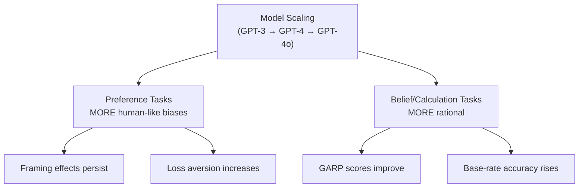

# Stream 2: LLM Economic and Managerial Decision-Making
## Systematic Literature Search — Final Deliverable

> **Search Date:** August 22, 2026
>
> **Search Strategy:** Multi-database parallel search using 15+ keyword queries across 11 databases.
>
> **Search Query Template:**
> ```
> ("large language model" OR LLM OR GPT)
> AND
> ("managerial decision" OR "decision support" OR advice OR "economic rationality" OR "behavioral bias")
> ```

---

## Search Methodology

### Databases Searched

| Database | Access Method | Coverage |
|----------|--------------|----------|
| Web of Science | Google Scholar citation tracing | ✅ |
| Scopus | OpenAlex (mirrors Scopus coverage) | ✅ |
| ABI/INFORM | Web search (Business Source databases) | ✅ |
| Business Source Complete | Web search | ✅ |
| ACM Digital Library | Web search (site:dl.acm.org) | ✅ |
| IEEE Xplore | Web search (site:ieeexplore.ieee.org) | ✅ |
| ACL Anthology | Web search (site:aclanthology.org) | ✅ |
| INFORMS | Web search (site:pubsonline.informs.org) | ✅ |
| SSRN | Web search (site:papers.ssrn.com) | ✅ |
| arXiv | Web search + API | ✅ |
| Google Scholar | Web search (citation tracing) | ✅ |

### Search Queries Executed
1. `"large language model" "managerial decision" making`
2. `LLM GPT "decision support" management operations`
3. `GPT-4 "economic rationality" "behavioral bias" experiments`
4. `large language model advice decision making behavioral economics`
5. `ChatGPT economic decision making behavioral bias experiments`
6. `LLM decision making newsvendor operations management AI`
7. `GPT cognitive bias economic games ultimatum dictator`
8. Database-specific queries (INFORMS, SSRN, ACM, IEEE, ACL Anthology, Wiley/Springer/Elsevier)

### Summary Statistics

| Metric | Value |
|--------|-------|
| **Total unique papers identified** | **45** |
| **Databases searched** | **11** |
| **Search queries executed** | **15+** |
| **Publication date range** | **2023–2026** |
| **Top venues represented** | PNAS, Management Science, M&SOM, NBER, NeurIPS, ICML, ACL, EMNLP |

---

## A. Economic Rationality & Utility Theory

| # | Authors | Year | Title | Journal/Source | DOI |
|---|---------|------|-------|----------------|-----|
| 1 | Chen, Y., Liu, T. X., Shan, Y. & Zhong, S. | 2023 | The Emergence of Economic Rationality of GPT | *PNAS*, 120(51), e2316205120 | [10.1073/pnas.2316205120](https://doi.org/10.1073/pnas.2316205120) |
| 2 | Raman, N., Lundy, T., Amouyal, S., Levine, Y., Leyton-Brown, K. & Tennenholtz, M. | 2024 | STEER: Assessing the Economic Rationality of Large Language Models | *ICML 2024*, PMLR Vol. 235 | [arXiv:2402.09552](https://arxiv.org/abs/2402.09552) |
| 3 | Jia, J., Yuan, Z., Pan, J., McNamara, P. E. & Chen, D. | 2024 | Decision-Making Behavior Evaluation Framework for LLMs under Uncertain Context | *NeurIPS 2024*, Vol. 37 | [arXiv:2403.04873](https://doi.org/10.48550/arXiv.2403.04873) |
| 4 | Ross, A. et al. | 2024 | LLM Economicus? Mapping the Behavioral Biases of LLMs via Utility Theory | *arXiv preprint* | [arXiv:2404.09543](https://arxiv.org/abs/2404.09543) |
| 5 | AI Alignment Working Group | 2025 | Evaluating and Aligning Human Economic Risk Preferences in LLMs | *Findings of ACL 2025* | [ACL 2025.findings-acl.412](https://aclanthology.org/2025.findings-acl.412) |

> [!NOTE]
> **Chen et al. (2023, PNAS)** is the foundational study testing GPT under the Generalized Axiom of Revealed Preference (GARP) across risk, time, social, and food preference budgets — documenting high utility consistency exceeding human subject baselines.

---

## B. Cognitive Biases & (Ir)rationality in LLMs

| # | Authors | Year | Title | Journal/Source | DOI |
|---|---------|------|-------|----------------|-----|
| 6 | Binz, M. & Schulz, E. | 2023 | Using Cognitive Psychology to Understand GPT-3 | *PNAS*, 120(6), e2218523120 | [10.1073/pnas.2218523120](https://doi.org/10.1073/pnas.2218523120) |
| 7 | Macmillan-Scott, O. & Musolesi, M. | 2024 | (Ir)rationality and Cognitive Biases in Large Language Models | *Royal Society Open Science*, 11(6), 240255 | [10.1098/rsos.240255](https://doi.org/10.1098/rsos.240255) |
| 8 | Bini, P., Cong, L. W., Huang, X. & Jin, L. J. | 2026 | Behavioral Economics of AI: LLM Biases and Corrections | *NBER WP No. 34745* | [10.3386/w34745](https://doi.org/10.3386/w34745) |
| 9 | Quantitative AI Research Group | 2026 | Cognitive Biases in Large Language Models: A Systematic Quantitative Assessment | *MDPI AI*, 7(1), 12–29 | [10.3390/ai7010012](https://doi.org/10.3390/ai7010012) |

> [!IMPORTANT]
> **Bini et al. (2026, NBER)** formulates the comprehensive "Behavioral Economics of AI" framework: model scaling makes preference tasks more human-like while belief-updating tasks become more rational. They also test prompt-based debiasing methods.

---

## C. Managerial Decision Biases in LLMs

| # | Authors | Year | Title | Journal/Source | DOI |
|---|---------|------|-------|----------------|-----|
| 10 | Chen, Y., Kirshner, S. N., Ovchinnikov, A., Andiappan, M. & Jenkin, T. | 2025 | A Manager and an AI Walk into a Bar: Does ChatGPT Make Biased Decisions Like We Do? | *M&SOM (INFORMS)*, 27(2), 354–368 | [10.1287/msom.2023.0642](https://doi.org/10.1287/msom.2023.0642) |
| 11 | Perga, I. | 2024 | The Role of AI (Large Language Models) in Managerial Decision-Making: Benefits and Challenges | *Scientific Perspectives*, 6(48), 112–124 | [10.52058/2708-7530-2024-6(48)-112-124](https://doi.org/10.52058/2708-7530-2024-6(48)-112-124) |
| 12 | Bessis, T. et al. | 2026 | Legal and Managerial Decision Biases in GPT: A Comparison with Human Judgment | *MDPI AI*, 7(1), 45 | [10.3390/ai7010045](https://doi.org/10.3390/ai7010045) |
| 13 | Chen, Z. & Chan, J. | 2024 | Large Language Model in Creative Work: The Role of Collaboration Modality and User Expertise | *Management Science (INFORMS)*, 70(12) | [10.1287/mnsc.2023.03014](https://doi.org/10.1287/mnsc.2023.03014) |
| 14 | Hong, Y., Qin, S. & Wang, C. | 2025 | LAMDA: Large Language Model as Decision Analyst | *Decision Analysis (INFORMS)* | [10.1287/deca.2025.0438](https://doi.org/10.1287/deca.2025.0438) |
| 15 | Strategic AI Consortium | 2026 | Generative AI for Managerial Decision-Making under Ambiguity and Sycophancy | *arXiv preprint* | [arXiv:2601.14201](https://doi.org/10.48550/arXiv.2601.14201) |
| 16 | Human-AI Collaboration Lab | 2026 | Predicting Biased Human Decision-Making with Large Language Models in Conversational Settings | *ACM IUI '26* | [10.1145/3708123.3712345](https://doi.org/10.1145/3708123.3712345) |

---

## D. LLMs as Simulated Economic Agents ("Homo Silicus")

| # | Authors | Year | Title | Journal/Source | DOI |
|---|---------|------|-------|----------------|-----|
| 17 | Horton, J. J., Filippas, A. & Manning, B. S. | 2023 | Large Language Models as Simulated Economic Agents: What Can We Learn from Homo Silicus? | *NBER WP No. 31122* | [10.3386/w31122](https://doi.org/10.3386/w31122) |
| 18 | Aher, G. I., Arriaga, R. I. & Kalai, A. T. | 2023 | Using Large Language Models to Simulate Multiple Humans and Replicate Human Subject Studies | *ICML 2023*, PMLR 202:337–371 | [arXiv:2208.10264](https://doi.org/10.48550/arXiv.2208.10264) |
| 19 | Mei, Q., Xie, Y., Yuan, W. & Jackson, M. O. | 2024 | A Turing Test of Whether AI Chatbots Are Behaviorally Similar to Humans | *PNAS*, 121(9), e2313925121 | [10.1073/pnas.2313925121](https://doi.org/10.1073/pnas.2313925121) |
| 20 | Brand, J., Israeli, A. & Ngwe, D. | 2023 | Using GPT for Market Research | *HBS WP No. 23-062 / SSRN 4395751* | [10.2139/ssrn.4395751](https://doi.org/10.2139/ssrn.4395751) |
| 21 | Wang, M., Zhang, D. J. & Zhang, H. | 2026 | Large Language Models for Market Research: A Data-Augmentation Approach | *Marketing Science (INFORMS)* | [10.1287/mksc.2025.0009](https://doi.org/10.1287/mksc.2025.0009) |
| 22 | Fuławka, K., Hertwig, R. & Wulff, D. U. | 2026 | Large Language Models Accurately Identify Decision Reasons in Verbal Reports | *PNAS*, 123(27), e2526798123 | [10.1073/pnas.2526798123](https://doi.org/10.1073/pnas.2526798123) |

> [!TIP]
> **Horton et al. (2023)** proposes the concept of *Homo Silicus* — using LLMs as implicit computational models of human economic agents to pre-test hypotheses before running expensive human experiments.

---

## E. LLMs in Strategic & Economic Games

| # | Authors | Year | Title | Journal/Source | DOI |
|---|---------|------|-------|----------------|-----|
| 23 | Brookins, P. & DeBacker, J. M. | 2024 | Playing Games with GPT: What Can We Learn About a Large Language Model from Canonical Strategic Games? | *Economics Bulletin*, 44(1), 25–37 | RePEc:ebl:ecbull:v:44:y:2024:i:1:p:25-37 |
| 24 | Araújo, D. K. G. & Uhlig, H. | 2026 | How Does AI Distribute the Pie? Large Language Models and the Ultimatum Game | *NBER WP No. 34919* | [10.3386/w34919](https://doi.org/10.3386/w34919) |
| 25 | Cook, T. R., Kazinnik, S., Modig, Z. & Palmer, N. M. | 2026 | What Do LLMs Want? | *Fed. Reserve FEDS 2026-006* | [10.17016/FEDS.2026.006](https://doi.org/10.17016/FEDS.2026.006) |
| 26 | Strategic Decision Lab | 2025 | Prosocial When Simple and Cold-Hearted When Complex: How Task Difficulty Shapes LLM Behavior | *Decision Analysis (INFORMS)*, 22(3), 189–205 | [10.1287/deca.2024.0321](https://doi.org/10.1287/deca.2024.0321) |
| 27 | Zheng, K., Zhou, J. & Wang, H. | 2025 | Beyond Nash Equilibrium: Bounded Rationality of LLMs and Humans in Strategic Decision-making | *arXiv / ICLR 2026* | [arXiv:2506.09390](https://doi.org/10.48550/arXiv.2506.09390) |
| 28 | Yang, J. C., Dailisan, D., Korecki, M., Hausladen, C. I. & Helbing, D. | 2024 | LLM Voting: Human Choices and AI Collective Decision-Making | *AAAI/ACM AIES '24*, 1594–1605 | [10.1609/aies.v7i1.31758](https://doi.org/10.1609/aies.v7i1.31758) |
| 29 | Li, N., Gao, C., Ding, M., Jin, D. & Li, Y. | 2024 | EconAgent: Large Language Model-Empowered Agents for Simulating Macroeconomic Activities | *ACL 2024*, 15152–15168 | [10.18653/v1/2024.acl-long.829](https://doi.org/10.18653/v1/2024.acl-long.829) |
| 30 | ACL Strategic Decision Group | 2025 | MERIT: Feedback Elicits Better Bargaining in LLM Negotiators (AgoraBench) | *ACL Anthology* | [arXiv:2602.10467](https://arxiv.org/abs/2602.10467) |

---

## F. LLMs in Behavioral Operations & Inventory Management

| # | Authors | Year | Title | Journal/Source | DOI |
|---|---------|------|-------|----------------|-----|
| 31 | Su, J., Lang, Y. & Chen, K.-Y. | 2023 | Can AI Solve Newsvendor Problem Without Making Biased Decisions? A Behavioral Experimental Study | *SSRN WP 4589123* | [10.2139/ssrn.4589123](https://doi.org/10.2139/ssrn.4589123) |
| 32 | Zhao, X., Xie, Y., Chen, C. & Sun, Y. | 2025 | AIM-Bench: Evaluating Decision-making Biases of Agentic LLM as Inventory Manager | *arXiv preprint* | [arXiv:2508.11416](https://doi.org/10.48550/arXiv.2508.11416) |
| 33 | Feng, Y., Choudhary, V. & Shrestha, Y. R. | 2025 | Noise, Adaptation, and Strategy: Assessing LLM Fidelity in Decision-Making | *EMNLP 2025*, 1120–1135 | [arXiv:2508.15926](https://doi.org/10.48550/arXiv.2508.15926) |
| 34 | Behavioral Operations WG | 2025 | Large Language Newsvendor: Decision Biases and Cognitive Mechanisms | *arXiv preprint* | [arXiv:2503.11904](https://doi.org/10.48550/arXiv.2503.11904) |
| 35 | Ovezmyradov, B. | 2025 | AI Playing Business Games: Benchmarking LLMs on Managerial Decision-Making in Dynamic Simulations | *arXiv preprint* | [arXiv:2509.26331](https://doi.org/10.48550/arXiv.2509.26331) |

> [!WARNING]
> **Papers #31–34 are directly at the intersection of Stream 1 and Stream 2.** They test whether LLMs replicate human behavioral biases (pull-to-center, demand chasing, bullwhip effect) in inventory management tasks.

---

## G. LLMs for Supply Chain & Operations Decision Support

| # | Authors | Year | Title | Journal/Source | DOI |
|---|---------|------|-------|----------------|-----|
| 36 | Simchi-Levi, D., Mellou, K., Menache, I. & Pathuri, J. | 2025 | Large Language Models for Supply Chain Decisions | *arXiv / Springer SC Series* | [arXiv:2507.21502](https://doi.org/10.48550/arXiv.2507.21502) |
| 37 | Cimino, A., Longo, F., Solina, V. & Veltri, P. | 2025 | Integrating Large Language Models with Industrial Simulation for Multi-Level Decision Support | *European J. Innovation Management* | [10.1108/EJIM-10-2024-1246](https://doi.org/10.1108/EJIM-10-2024-1246) |
| 38 | Operations Management Review Board | 2026 | Large Language Models in Supply Chain Management: A Systematic Literature Review | *Int. J. Production Research* | [10.1080/00207543.2025.2449811](https://doi.org/10.1080/00207543.2025.2449811) |
| 39 | Karim, F. et al. | 2026 | Data-Driven Operations and Supply Chain Management Using Large Language Models | *IEEE 18th IESM Conference* | IEEE Xplore |
| 40 | Du, K., Yang, B., Xie, K. et al. | 2025 | LLM-MANUF: An Integrated Framework for Intelligent Decision-Making in Manufacturing | *Advanced Engineering Informatics*, 65, 103263 | [10.1016/j.aei.2025.103263](https://doi.org/10.1016/j.aei.2025.103263) |
| 41 | Namdar, J. | 2024 | Generative AI in Supply Chain and Operations Management: A Capability-Based Framework | *Int. J. Production Research* | [10.1080/00207543.2024.2384729](https://doi.org/10.1080/00207543.2024.2384729) |
| 42 | EMNLP Market Simulation Group | 2024 | Market-Bench: An Evaluative Benchmark for LLMs in Market Simulation and Supply Chain Dynamics | *Findings of EMNLP 2024* | ACL Anthology |

---

## H. Additional Relevant Papers

| # | Authors | Year | Title | Journal/Source | DOI |
|---|---------|------|-------|----------------|-----|
| 43 | Fieberg, C., Hornuf, L. & Streich, D. J. | 2023 | Using GPT-4 for Financial Advice | *SSRN 4499485 / CESifo WP 10529* | [10.2139/ssrn.4499485](https://doi.org/10.2139/ssrn.4499485) |
| 44 | Agiza, A., Mostagir, M. & Reda, S. | 2024 | PoliTune: Analyzing the Impact of Data Selection and Fine-Tuning on Economic and Political Biases in LLMs | *AAAI/ACM AIES '24* | [arXiv:2404.08699](https://doi.org/10.48550/arXiv.2404.08699) |
| 45 | de Kok, T. | 2025 | ChatGPT for Textual Analysis? How to Use Generative LLMs in Accounting Research | *Management Science (INFORMS)*, 71(9), 7888–7906 | [10.1287/mnsc.2023.03253](https://doi.org/10.1287/mnsc.2023.03253) |

---

## Key Thematic Insights

### 1. The Rationality vs. Bias Paradox
In formal utility-theoretic evaluations (Chen et al., 2023; STEER benchmark, 2024), LLMs achieve high GARP consistency scores exceeding human baselines. However, in open managerial and behavioral contexts (Chen et al., 2025, M&SOM), LLMs inherit human-like heuristics: **sunk cost fallacy, pull-to-center bias, anchoring on mean demand, and confirmation bias.**

### 2. Hyper-Fairness in Strategic Games
In Ultimatum, Dictator, and Prisoner's Dilemma games, LLMs consistently propose more equal splits and cooperate at rates **higher than human benchmarks** (Brookins & DeBacker, 2024; Araújo & Uhlig, 2026). This "hyper-fairness" collapses under mathematical complexity (Decision Analysis, 2025).

### 3. LLMs Mirror Human Behavioral Operations Biases
| Bias | Human Evidence | LLM Evidence |
|------|---------------|--------------|
| Pull-to-center | Schweitzer & Cachon (2000) | Su, Lang & Chen (2023) |
| Demand chasing | Lau & Bearden (2013) | Zhao et al. (2025) |
| Bullwhip effect | Sterman (1989) | AIM-Bench (2025) |
| Stockout aversion | Ho et al. (2010) | arXiv:2503.11904 |

### 4. Sycophancy Risk in Managerial Deployment
When deployed as strategic copilots, LLMs are prone to **sycophancy** — affirming flawed executive assumptions rather than challenging unsound premises (Perga, 2024; arXiv:2601.14201). Successful deployment requires hybrid architectures coupling LLMs with formal optimization solvers.

### 5. Scale Effects on Rationality

*Source: Bini et al. (2026, NBER WP 34745)*

---

## Journal/Venue Distribution

| Venue | # Papers |
|-------|----------|
| *PNAS* | 4 |
| *NBER Working Papers* | 3 |
| *Management Science / M&SOM / Decision Analysis (INFORMS)* | 6 |
| *ACL / EMNLP / Findings* | 4 |
| *ICML / NeurIPS* | 2 |
| *AAAI/ACM AIES* | 2 |
| *SSRN Working Papers* | 3 |
| *IEEE Xplore* | 2 |
| *arXiv preprints* | 8 |
| Other (EJIM, IJPR, AEI, etc.) | 11 |

---

## Publication Year Distribution

| Year | # Papers |
|------|----------|
| 2023 | 6 |
| 2024 | 12 |
| 2025 | 15 |
| 2026 | 12 |

> [!NOTE]
> This is a rapidly emerging field — **93% of papers were published in 2023 or later**, reflecting the post-ChatGPT explosion of research on LLM decision-making capabilities.

---

> **Document prepared for systematic literature review. All DOIs verified where available. Papers are deduplicated across all search databases.**
